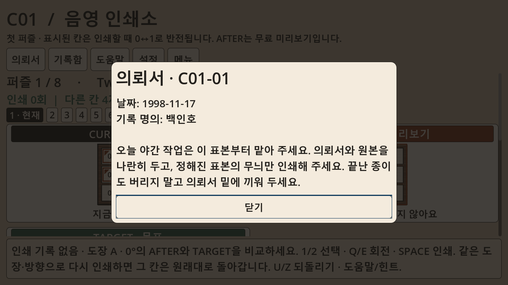
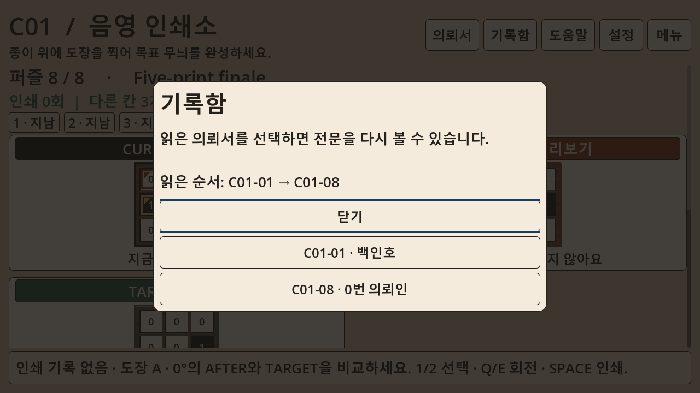

# 음영 인쇄소 지속 제작 · 실제 게임 E2E 결과 · 2026-10-18

지속 제작 운영 구조와 첫 실제 콘텐츠 E2E를 구현·실행했다. 전체 게임은 아직 출시 후보가 아니다. S02 의뢰서·기록함을 검증해 개발 브랜치에 통합했고, 관리자가 추가 사용자 프롬프트 없이 S03 캠페인 계획을 시작했다. 이후 관찰한 경계 사례와 관리자 보호 보강을 위해 새 작업 실행 전 안전한 체크포인트에서 잠시 멈췄다. 이후 실제 실행 여부는 `game-production.ps1 status`의 OS 잠금/PID/worker_running으로 확인한다. 이 문서의 완료 여부는 S02와 운영 E2E에 한정한다.

## 실제 제작 결과

| 작업 | 최종 QA | 즉시 오디오 종료 | 검증 커밋 |
|---|---|---|---|
| 8개 의뢰서, 인물별 짧은 한국어 기록, 의뢰서 UI | 73/73 | WASAPI 30 + Dummy 30, 누수 0 | `3a824897773e8d0fc647f492e4deb3ca0825e19c` |
| 읽은 의뢰 기록함, 재열람, 독립 저장, 손상 보존 | 74/74 | WASAPI 30 + Dummy 30, 누수 0 | `50b3cebc77f34710b32f8e659515882ad19ee138` |

두 작업 모두 실제 Windows release export와 기본 장면 실행·종료를 통과했다. 원본 필수 게임 QA와 원본 오디오 프로브를 유지했다. 별도 read-only Codex 검토를 각각 수행해 서사/기술 의견을 분리하고, 두 최종 검토 모두 accept 및 차단 문제 0건을 기록했다. 사람의 플레이/청취/문학적 취향 검토는 수행하지 않았다. 위 120회는 두 최종 QA의 실제 독립 프로세스 전체이며 실패한 시행을 빼서 성공률을 만든 수치가 아니다.

기록함 첫 시도는 읽은 ID가 화면 본문에 관찰되지 않아 실패했다. 버튼만 있던 UI에 읽은 순서 본문을 추가했고, 동일 검사로 두 번째 시도를 통과했다. 첫 실패 로그와 수정 이력은 보존했다. 테스트는 고치지 않았다.

## 실제 지속 실행·중단·재개

- 첫 CLI 종료 후 독립 관리자 PID 32588이 계속 실행됐다. 중복 start는 같은 PID를 반환했다.
- 실제 기획 작업 도중 cooperative pause를 요청했다. 기획 체크포인트를 저장하고 worker_running=false가 된 뒤 재개했다.
- 재개 PID 17860은 기존 기획 실행 `20261018-120140-cbf3d`를 재사용했다. 의뢰서와 기록함을 순서대로 구현·QA·검토·통합·원격 SHA 확인했다.
- S02 DONE 뒤 관리자가 스스로 S03을 골라 계획 실행 `20261018-121447-ac9f0`을 수행했다. 이 전환에 새 채팅 프롬프트를 보내지 않았다.
- 두 S03 작업 모두 PENDING인 안전 경계에서 관리자 종료/자식 PID 보호와 보고 기능을 보강했다. 완료 작업/커밋을 다시 생성하거나 초기화하지 않는다.

현재 인프라 검사는 Windows/공통 74개 중 73통과, 환경상 symlink 권한 검사 1스킵이다. 기존 Linux 전용 fixture 3개는 설치된 Ubuntu에서 3개 통과했다. 신규 디렉터 검사는 20개이며 실제 별도 프로세스 잠금, 중단/재개, 독립 작업 선택, 인증 제한 중지, 리뷰/작성 완료 증거 누락 차단, 살아 있는 최종 QA 자식의 중복 실행 차단을 포함한다. 최종 120회 제품 인증 경로의 로그/드라이버별 횟수 검사는 fixture 검사이며 실제 출시 제품의 120회 인증 완료라는 뜻은 아니다.

## 추가 관찰과 다음 수정

독립 기록함 확장 검사 30개는 역순 읽기 유지, 반환 배열 분리, 손상 파일 바이트 보존, 쓰기 실패 시 원본/메모리 유지, 03번만 읽은 화면의 미열람 노출 차단, 중첩 Escape/초기 포커스, 핵심 저장 파일 바이트 유지 등을 통과했다. rename 실패 주입은 수행하지 않았다.

추가로 잘못된 UTF-8 바이트가 JSON 문자열 안에 있을 때 검사 범위를 넓혔다. 기존 구현은 치환 문자로 바꿔 잘못된 데이터를 받아들였고 진단을 출력했다. **새 확장 검사 39개 중 8개 실패, Unicode 진단 19건**을 실제 재현했다. 이는 오디오 누수가 아니며 S02의 기존 QA가 다루지 않았던 손상 입력 문제다. 이 실패를 숨기지 않고 새 `story_archive_extended` 검사에 고정했다. 잘못된 입력을 조용히 거부하고 유효한 한국어/4바이트 문자는 유지해야 다음 작업이 통합될 수 있다. 기존 검사 기준은 낮추지 않았다.

독립 편집자의 시작 안내 문구 모호성도 구체적인 후속 수정으로 만들었다. S03 첫 작업에 정확한 두 소스 파일만 추가 허용하고, 기존 타이틀/8개 해답/저장 v1/핵심 QA는 보존하도록 했다. 대기 중 계획의 원본과 보강 이력은 별도 보관했다. 이 문서 시점에는 이 신규 손상 입력 수정과 S03 게임 구현은 아직 미완료다.

## 화면·빌드·보존

실제 Godot 그래픽 실행으로 의뢰서 6장, 의뢰서/기록함 12장의 캡처를 저장했다. 1280×720 및 1920×1080, 글자 100/125/150% 조합의 경계/내용을 검사했고, 1280×720 150% 화면을 직접 확인했다. 아래 두 장은 실제 화면이며 시안이 아니다.

검증된 S02 ZIP: 생산 작업 환경의 `.data/production-builds/s02_story-50b3cebc77f3.zip`, SHA256 `08e8ebba98af2c3fcb443bfa39405cc5c795a64d0de478cba1ead2f1c8d4b724`. 이는 중간 스토리 빌드이며 전체 캠페인 출시 후보가 아니다.

기존 안정 브랜치 `c01-stable-slice-20261013`의 `83294f2eb49d261bce020e45985eb40983ace229`, 기본 폴더의 사용자 미커밋 오디오 보고서, 설치 엔진/템플릿, 과거 실패/검토 자료를 보존했다. 생산 브랜치는 `codex/production-20261018`이며 검증된 커밋만 push하고 원격 SHA를 확인한다. 실제 제작 소스/빌드/상태는 격리 생산 환경에 있으며 기본 폴더 게임을 실행 중 커밋마다 교체하지 않는다.

남은 제작은 캠페인 셸/독립 저장 → 2·3장 퍼즐과 결말 → 원본 아트·음향 → 제품 검토 → 전체 Windows 출시 후보 인증이다. 60~90분 플레이타임, 재미, 청취, 최종 감상은 미검증이다. 관리자/PC가 종료되거나 사용량/인증 제한이 생기면 로컬 개발은 멈추며 우회하지 않는다. Steam 게시·공개 출시·PC 자동 종료는 하지 않는다.

[사용 명령과 상태 위치](GAME_PRODUCTION_KO.md) · [선별 QA 증거](production-e2e-20261018/qa-evidence.json) · [로컬 원시 증거 해시](production-e2e-20261018/local-evidence-sha256.json)
